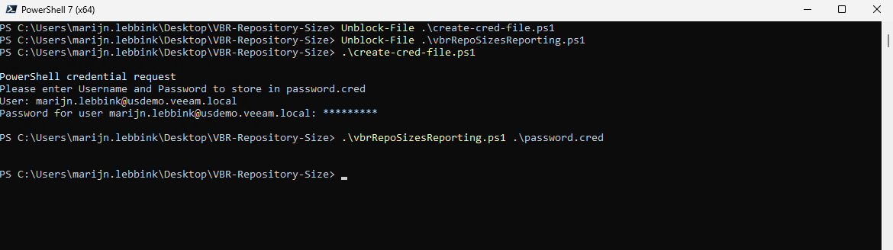
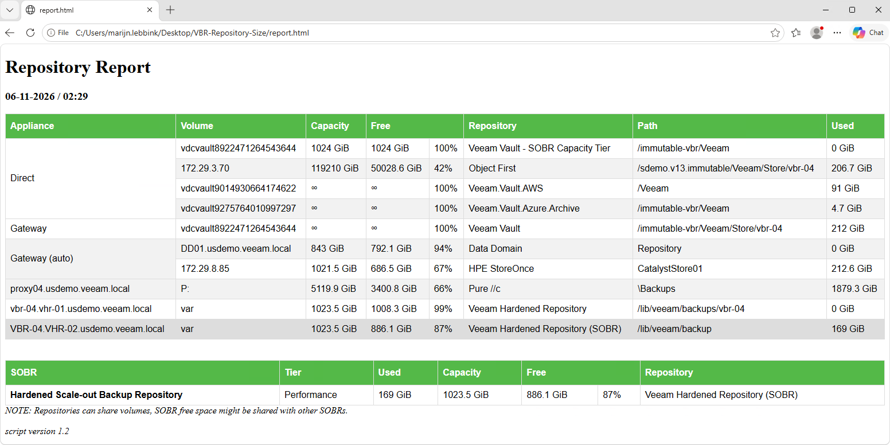

This Powershell scripts connects to the Veeam Backup & Replication host and creates a report to show all repositories and SOBRS.

**Preperation:**
1) create credential file(s) using the create-cred-file.ps1 script. This script uses the credential object and serializes is to a file. This ensures the password file can only be opened on the same host by same user. Make at least one credential file with the login and password for a VBR service account, this should be a service account.
2) Set the required variables in the file vbrRepoSizesReporting.ps1. Main variable is the VBR FQDN.

**Usage:**
run the script: .\vbrRepoSizesReporting.ps1 .\password.cred to create the html report.

This will create a report showing repositories and, when applicable, Scale-Out Backup Repositories.

